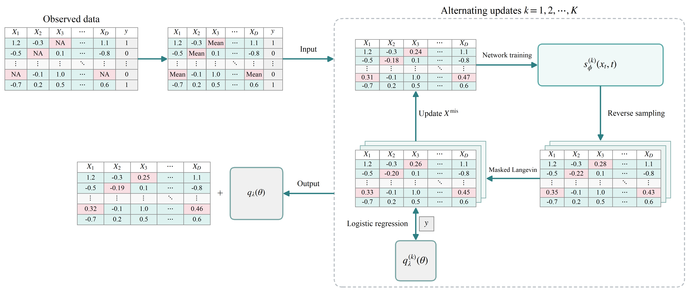

# DVAI

## Python and dependencies

Reference environment:

- Python 3.12.2
- PyTorch 2.9.1
- NumPy 2.4.0
- Pandas 2.3.3
- SciPy 1.16.3
- scikit-learn 1.8.0
- threadpoolctl 3.6.0

For GPU support, install a compatible PyTorch CUDA build:
https://pytorch.org/get-started/previous-versions/#v291

## Method overview

DVAI performs Bayesian logistic regression with missing covariates through alternating updates:

1. Train a diffusion model on the currently completed covariates.
2. Generate imputed samples through reverse-time sampling and masked Langevin refinement.
3. Update the variational posterior of the regression coefficients using these samples.
4. Update imputations using sample means and compare consecutive posteriors to assess convergence.

## Experiments

Run the following scripts from the project root:

- `simulation_main.py`: simulation experiments.
- `support2_main.py --run`: SUPPORT2 experiments with naturally missing covariates; 
## Baseline references

- MICE: https://scikit-learn.org/stable/modules/generated/sklearn.impute.IterativeImputer.html
- Random forests used in MissForest: https://scikit-learn.org/stable/modules/generated/sklearn.ensemble.RandomForestRegressor.html
- MIWAE: https://github.com/pamattei/miwae
- DiffPuter: https://github.com/hengruizhang98/DiffPuter
